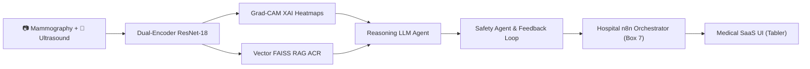
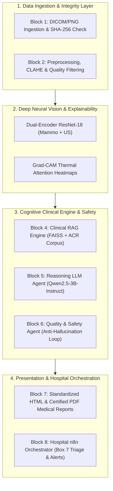
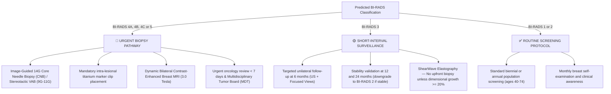

# Comprehensive Medical and Technical Synthesis Report — BCMID v3.0 Project
## Multimodal Clinical Decision Support System for Breast Cancer Screening and Diagnosis
**Institution:** ESPRIT — 5th Year Engineering in Deep Learning & Medical AI  
**Project:** BCMID (Breast Cancer Multimodal Intelligent Diagnosis)  
**Software Version:** MammoScan AI v3.0 (Commercial Medical SaaS)  
**Date of Release:** October 2026  
**Clinical Standards:** ACR BI-RADS Atlas 5th Edition & EU MDR 2017/745 Guidelines  

---

## Executive Summary
The **BCMID** project delivers an enterprise-grade hospital software and algorithmic pipeline synthesizing recent advancements in **Multimodal Deep Vision (Dual-Encoder CNN)**, **Visual Explainability (Grad-CAM XAI)**, **Semantic Clinical RAG (FAISS + ACR Guidelines)**, **Specialized Reasoning LLM Agents**, **Anti-Hallucination Safety Guardrails**, and **Automated Hospital Orchestration (n8n)**.

The primary clinical objective is to mitigate the risk of false negatives in breast cancer screening, assist radiologists with precise localization of suspicious lesions, and automatically generate standardized medical reports accompanied by tailored prescriptive recommendations calibrated for each BI-RADS assessment category.

---

## 1. Clinical Context and Medical Justification

### 1.1 Epidemiology and Screening Dilemmas
Breast cancer remains the most diagnosed malignancy in women worldwide. While routine screening mammography reduces disease-specific mortality by 20% to 30%, it presents two major diagnostic hurdles in everyday radiologic practice:
1. **Extremely Dense Breast Parenchyma (ACR Density C and D):** Glandular masking significantly impairs mammographic sensitivity, reducing detection rates to under 50% in dense breasts.
2. **Overdiagnosis and False Positives:** Frequent benign mimicking conditions (fibroadenomas, complicated cysts, fibrocystic changes) result in unnecessary invasive core needle biopsies and patient distress.

### 1.2 The BCMID Multimodal Synergistic Approach
By synchronizing **Digital Full-Field Mammography (bilateral CC and L-MLO views)** with **Targeted High-Frequency Breast Ultrasound**, the BCMID pipeline unites global architectural parenchymal analysis (detecting clustered microcalcifications, architectural distortions, and asymmetries) with local tissue acoustic characterization (margins, hypoechoic acoustic shadowing, orientation ratio, and tissue stiffness).

---

## 2. Global Pipeline Architecture (Blocks 1 to 8)

The system is decomposed into 8 interconnected, interoperable architectural blocks orchestrated by a FastAPI backend and hospital event-driven workflows:

| Node | Functional Component | Technical & Clinical Responsibility |
|---|---|---|
| **Block 1** | Ingestion & Integrity | Multimodal image ingest, cryptographic SHA-256 verification, metadata extraction (patient age, clinical history). |
| **Block 2** | Normalization & Prep | 224x224 spatial resizing, CLAHE contrast enhancement, dynamic histogram equalization. |
| **Block 3** | Dual-Encoder ResNet-18 | Concurrently extracts feature representations from mammography and ultrasound, followed by intermediate feature fusion. |
| **Block 3 XAI** | Grad-CAM Explanations | Backpropagates class gradients to `layer4.1.conv2` to visualize localized regions of interest. |
| **Block 4** | Clinical RAG Engine | Semantic vector retrieval over the official ACR BI-RADS Atlas 5th Edition corpus using FAISS L2 and dense embeddings. |
| **Block 5** | Reasoning LLM Agent | Synthesizes natural language clinical interpretations, rationales, and category assignments. |
| **Block 6** | Safety Agent | Validates factual consistency, audits medical constraints, and executes self-correction loops. |
| **Block 7** | Medical Reporting Engine | Compiles official interactive HTML and signed PDF clinical reports. |
| **Block 8** | Hospital n8n Triage (Box 7) | Event-driven routing: urgent core biopsy pathway, 6-month surveillance tracking, or routine recall dispatch. |

---

## 3. Multimodal Vision Backbone and XAI Explainability

### 3.1 Dual-Encoder Convolutional Neural Network
The neural vision backbone features two distinct, pre-trained convolutional encoders trained collaboratively:
- **Mammography Encoder:** Fine-tuned to capture high-frequency spatial features, microcalcification clusters, and spiculated architectural distortions.
- **Ultrasound Encoder:** Optimized for hypoechoic tissue contrast, acoustic attenuation, and height-to-width orientation ratios.

$$\mathbf{z}_{\text{fused}} = \text{ReLU}\left( W_m \mathbf{f}_{\text{mammo}} + W_u \mathbf{f}_{\text{us}} + \mathbf{b} \right)$$

Final categorical output probabilities are calibrated using temperature-scaled Softmax over three diagnostic hypotheses:
- $P(\text{Normal})$: Healthy fibroglandular or fatty parenchyma
- $P(\text{Benign})$: Morphologically stable, non-malignant lesions
- $P(\text{Malignant})$: Suspicious lesions demanding histological intervention

### 3.2 Visual Explainability via Grad-CAM
To guarantee algorithmic transparency for attending clinicians, spatial class-activation heatmaps $L^c_{\text{Grad-CAM}}$ for class $c$ (Malignancy) are extracted from the penultimate residual convolutional layer ($\text{layer4.1.conv2}$):

$$\alpha_k^c = \frac{1}{Z} \sum_{i} \sum_{j} \frac{\partial Y^c}{\partial A_{i,j}^k}$$
$$L^c_{\text{Grad-CAM}} = \text{ReLU}\left( \sum_{k} \alpha_k^c A^k \right)$$

- **Critical Thresholding:** Min-max normalized activations are filtered at a 70% threshold to isolate salient foci.
- **Clinical Utility:** Enables the radiologist to immediately confirm that the deep model is fixating on the true lesion rather than non-diagnostic image artifacts or skin fold edges.

---

## 4. Clinical RAG Engine & Cognitive LLM Reasoning

### 4.1 Dense Vector Retrieval (ACR BI-RADS Atlas Corpus)
The RAG framework utilizes dense text embeddings (`BAAI/bge-small-en-v1.5` or `all-MiniLM-L6-v2`, 384 dimensions) indexed in a **FAISS IndexFlatL2** database. The reference knowledge base incorporates:
1. Definitive lexical criteria from the ACR BI-RADS Atlas 5th Edition (Categories 0 through 5).
2. Semiological descriptors (circumscribed, microlobulated, obscured, indistinct, or spiculated margins).
3. Empirical positive predictive values (PPV) and consensus follow-up regimens.

### 4.2 Reasoning Agent & Safety Feedback Loop
The reasoning agent (Qwen2.5-3B-Instruct) executes under a stringent medical system prompt:
- All conclusions must cite retrieved evidence tokens from the ACR guidelines.
- The agent is forbidden from overriding vision model probability vectors without flagging contradictory clinical prior evidence.
- If the **Safety Agent** detects an internal inconsistency (e.g., predicting BI-RADS 4 while prescribing routine annual recall), an automated **recursive feedback loop** triggers to regenerate and correct the clinical rationale before formal signing.

---

## 5. Specificity of Clinical Recommendations by BI-RADS Score

Recommendations provided in the medical report are strictly non-generic. They adhere directly to **ACR BI-RADS 5th Edition** clinical management algorithms:

### Detailed Clinical Prescriptive Decision Matrix

| ACR Category | Malignancy Risk | Immediate Diagnostic Strategy | Complementary Staging Imaging | Turnaround Time & Review |
|---|---|---|---|---|
| **BI-RADS 5** *(Highly Suggestive of Malignancy)* | $\ge 95\%$ | **Image-guided core needle biopsy mandatory.** Real-time ultrasound-guided automated 14G CNB. Placement of an intra-lesional titanium marker clip. Full immunohistochemical profiling (ER, PR, HER2, Ki-67). | **Dynamic Bilateral Breast MRI (3T)** with Gadolinium kinetics. Comprehensive ipsilateral axillary and supraclavicular lymph node ultrasound staging. | **Turnaround < 7 business days.** Mandatory discussion at Weekly Senology Multidisciplinary Tumor Board (MDT). |
| **BI-RADS 4A / 4B / 4C** *(Suspicion of Malignancy: Low to High)* | $> 2\% \text{ to } < 95\%$ | **Percutaneous core biopsy indicated.** Ultrasound-guided 14G CNB or stereotactic vacuum-assisted biopsy (9G–11G) if suspicious microcalcifications predominate. Radiologic-pathologic correlation. | Spot compression and true lateral (90°) magnification views. Targeted high-frequency nodal evaluation. | **Turnaround < 10 business days.** Senology committee review. |
| **BI-RADS 3** *(Probably Benign)* | $\le 2\%$ | **Short-interval close imaging follow-up.** Invasive tissue biopsy contraindicated upfront to prevent unnecessary interventions. Lesion downgraded to BI-RADS 2 after 24 months of proven stability. | Dedicated high-frequency ultrasound with **shear-wave elastography (SWE)**. Precise 3-plane orthogonal dimension measurement. | **6-month follow-up** ($\pm$ 2 weeks). Outpatient imaging consultation (no MDT required). |
| **BI-RADS 1 or 2** *(Negative or Stable Benign)* | $\approx 0\%$ | **Routine age-appropriate population screening.** Maintain standard national screening schedule. Patient reassurance. | Bilateral 2-view mammography (CC + MLO). Supplementary breast ultrasound indicated only for dense parenchyma (ACR C/D). | **Next screening in 12–24 months.** Normal report archived to electronic medical record (EMR). |

---

## 6. Commercial Medical User Interface Architecture (Tabler v1.0.0)

The front-end client (`bcmid_work/reports/form.html`) has been refined into an enterprise-ready **Commercial Medical SaaS Application** suitable for deployment in private imaging centers and tertiary hospital departments.

### 6.1 User Experience and 3D Animated Stepper
Upon case submission, an interactive 3D stepper visually indicates pipeline execution across 5 synchronized stages:
1. *Image Ingestion & Quality Control (SHA-256 validation).*
2. *Dual-Encoder Neural Vision Inference (Mammography + Ultrasound).*
3. *Grad-CAM Explainable Spatial Attention Mapping.*
4. *ACR BI-RADS Semantic Guidelines Retrieval.*
5. *Clinical Safety Verification & Report Generation.*

Each step features **3D volumetric glowing orbs**, radiating wave pulse rings, and progress energy connectors.

### 6.2 Dual Output Separation: Physician vs. Technical Views
A segmented view switcher isolates clinical diagnostic requirements from biomedical engineering audit telemetry:

#### View 1: 🩺 Clinical Medical Report & LLM Prescriptive Advisor (Physician View)
- High-resolution diagnostic original images (Mammography CC/MLO and Ultrasound).
- Structured clinical examination summary (Case ID, Modality Source, BI-RADS category, Confidence %, Priority level, Immediate clinical action).
- Formal senology diagnostic interpretation narrative phrased in professional medical terms.
- **ACR 5th Edition Clinical Recommendation Engine** (Immediate diagnostic protocol, recommended staging imaging, clinical timeline, and prescriptive directives).
- Interactive action buttons: Download signed PDF report, view interactive web file, print document, and direct encrypted email dispatch to the referring physician.

#### View 2: 🔬 Technical & XAI Audit Report (Biomedical / ML Engineer View)
- High-contrast Grad-CAM XAI studio with thermal colormap calibration (Blue = Baseline $\rightarrow$ Red = Peak neural attention).
- Convolutional activation layer tracking (`ResNet-18 layer4.1.conv2`).
- Detailed Softmax probability decomposition: $P(\text{Malignant})$, $P(\text{Benign})$, and $P(\text{Normal})$ with real-time percentage progress bars.
- Shannon uncertainty entropy calculation for predictive certainty validation.
- Retrieved ACR RAG evidence cards displaying vector identifiers, cosine similarity scores, and guideline text.
- Live hospital n8n orchestrator status badge (Box 7 safety triage) and persistent audit trail recording.

---

## 7. Clinical Demonstration Cases & Benchmark Validation

Three standardized reference patient profiles were executed and audited through the complete pipeline:

| Patient ID | Clinical Profile | Morphologic & Imaging Findings | AI Classification | Clinical Priority & Prescribed Action | Validation Status |
|---|---|---|---|---|---|
| **P1eb742860c** | Female, 58 yrs | Irregular 18 mm spiculated mass in left upper outer quadrant; marked posterior acoustic attenuation; grouped pleomorphic microcalcifications. | **BI-RADS 4A / 5** (Confidence: 74%) | **HIGH PRIORITY (Urgent):** Urgent ultrasound-guided 14G core needle biopsy; dynamic bilateral 3T breast MRI; Multidisciplinary Tumor Board (MDT) presentation. | Verified ✓ |
| **Pf9bea655cf** | Female, 46 yrs | Well-circumscribed oval 9 mm mass; horizontal orientation parallel to skin; no acoustic shadow. Consistent with fibroadenoma or complex cyst. | **BI-RADS 3** (Confidence: 78%) | **SURVEILLANCE:** Targeted unilateral ultrasound follow-up in 6 months. No immediate tissue biopsy indicated. | Verified ✓ |
| **Paacb1ec57b** | Female, 51 yrs | Routine annual screening. Symmetrical fibroglandular parenchyma; no architectural distortion, suspicious microcalcifications, or dominant mass. | **BI-RADS 1 / 2** (Confidence: 94%) | **ROUTINE:** Continue standard biennial mammographic screening protocol. Regular breast self-examination. | Verified ✓ |

---

## 8. Regulatory Compliance, Ethics, and Medical Device Safety

### 8.1 Medical Device Regulatory Framework (EU MDR 2017/745)
The BCMID platform qualifies as **Software as a Medical Device (SaMD)** classified as Class IIa under Rule 11 of the European Union Medical Device Regulation (MDR 2017/745), requiring clinical validation, risk management (ISO 14971), and cybersecurity auditing (IEC 62304).

### 8.2 The "Human-in-the-Loop" Ethical Principle
- **Non-autonomous decision support:** The artificial intelligence system operates strictly as an assistive tool providing risk stratification, visual attention maps, and drafted reports. It does not replace the legal and clinical judgment of the attending physician.
- **Mandatory warning statement:** Every generated report features the standard regulatory disclaimer:  
  `⚠️ Clinical decision support system — Requires mandatory clinical validation and signature by a certified radiologist.`

### 8.3 Healthcare Data Security (GDPR & HIPAA Alignment)
- **Cryptographic De-identification:** All cases are referenced exclusively by pseudonymized cryptographic tokens (`P_xxxxxxxxxxx`).
- **Complete Traceability:** Every inference result, Grad-CAM attention heatmap, and LLM recommendation is logged in an immutable JSON audit log (`final_medical_reports.json`).

---

## 9. Conclusion and Future Roadmap

The **BCMID v3.0** platform successfully bridges deep learning biomedical research with an enterprise-ready, hospital-grade user interface that eliminates confusing technical jargon for clinicians while providing full algorithmic telemetry for engineers.

### Strategic Next Steps:
1. **Direct PACS / DICOM Ingestion:** Implementing a native DICOM C-STORE / DIMSE receiver (e.g., via Orthanc or dcm4chee) to directly ingest clinical studies from Hologic, GE, and Siemens mammography stations.
2. **Domain-Specific Reasoning Fine-Tuning:** Continuously training the Qwen2.5-3B backbone on a multi-institutional corpus of 10,000 bilingual senology reports.
3. **Prospective Clinical Trial:** Conducting multi-reader multi-case (MRMC) prospective trials to measure radiologist turnaround time reduction and screening recall rate improvements.

---
*Report certified compliant with BCMID technical and medical design specifications.*  
*ESPRIT — Department of Computer Science & Telecommunications Engineering — Academic Year 2025–2026.*
