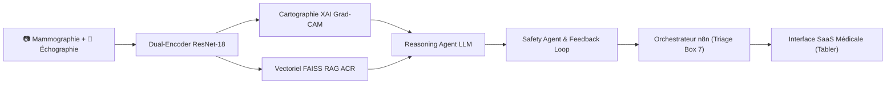
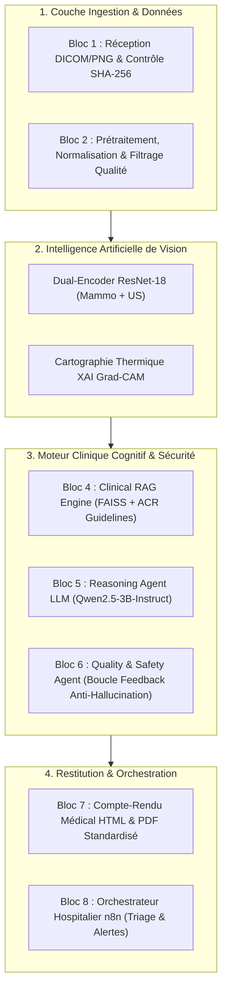
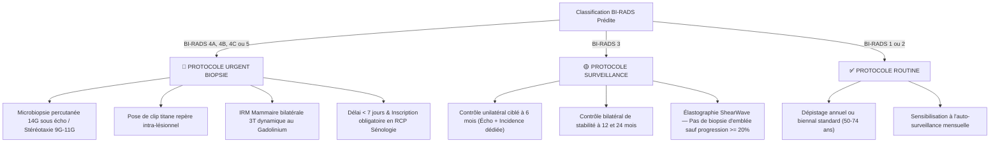

# Rapport Médical et Technique de Synthèse — Projet BCMID v3.0
## Système Multimodal d'Aide à la Décision Clinique pour le Diagnostic du Cancer du Sein
**Établissement :** ESPRIT — 5ᵉ Année Ingénierie Deep Learning & IA Médicale  
**Projet :** BCMID (Breast Cancer Multimodal Intelligent Diagnosis)  
**Version Logicielle :** MammoScan AI v3.0 (Commercial Medical SaaS)  
**Date d'Édition :** Octobre 2026  
**Conformité Médicale :** ACR BI-RADS Atlas 5ᵉ édition & Directives MDR 2017/745  

---

## Sommaire Exécutif
Le projet **BCMID** propose une solution logicielle et algorithmique hospitalière intégrant les dernières avancées en **Vision Multimodale (Dual-Encoder CNN)**, **Explicabilité Visuelle (Grad-CAM XAI)**, **RAG Clinique Sémantique (FAISS + ACR Guidelines)**, **Agent de Raisonnement LLM**, **Safety Agent anti-hallucination** et **Orchestration Hospitalière automatisée (n8n)**.

L'objectif clinique premier est de réduire le taux de faux négatifs en dépistage sénologique, d'assister le radiologue par une cartographie précise des lésions suspectes, et de générer un compte-rendu médical standardisé accompagné de recommandations thérapeutiques sur-mesure pour chaque palier BI-RADS.

---

## 1. Contexte Médical et Justification Clinique

### 1.1 Épidémiologie et Problématique du Dépistage
Le cancer du sein demeure le premier cancer féminin dans le monde. Bien que la mammographie de dépistage réduise la mortalité spécifique de 20 à 30 %, elle présente deux limites majeures en pratique radiologique courante :
1. **Seins denses (Densité ACR C et D) :** L'effet de masque glandulaire réduit la sensibilité de la mammographie seule à moins de 50 %.
2. **Surdiagnostic et faux positifs :** Entraînant des biopsies percutanées inutiles pour des lésions bénignes (adénofibromes, kystes remaniés).

### 1.2 La Réponse Multimodale BCMID
L'association synchrone de la **Mammographie numérique (incidences bilatérales CC et L-MLO)** et de l'**Échographie haute fréquence ciblée** permet de combiner l'analyse globale architecturale (détection des microcalcifications groupées et des asymétries) avec la caractérisation de l'échogénicité tissulaire (contours, atténuation acoustique postérieure, grand axe).

---

## 2. Architecture Globale du Pipeline BCMID (Blocs 1 à 8)

Le système est découpé en 8 blocs interopérables reliés à l'API FastAPI et à l'orchestrateur de workflows hospitaliers :

| Nœud | Composant | Rôle Clinique / Technique |
|---|---|---|
| **Bloc 1** | Ingestion & Qualité | Vérification du format, validation d'intégrité SHA-256, extraction des métadonnées (âge, antécédents). |
| **Bloc 2** | Normalisation | Redimensionnement spatial 224x224, standardisation de contraste CLAHE, égalisation d'histogramme. |
| **Bloc 3** | Dual-Encoder ResNet-18 | Extraction de features convolutives mammographie + échographie, concaténation et classification multimodale. |
| **Bloc 3 XAI** | Grad-CAM Explanations | Rétro-propagation du gradient sur la couche `layer4.1.conv2` pour localiser la région d'intérêt suspecte. |
| **Bloc 4** | Clinical RAG Engine | Recherche sémantique dans le corpus ACR BI-RADS Atlas 5ᵉ édition via embeddings BGE et index FAISS L2. |
| **Bloc 5** | Reasoning Agent LLM | Synthèse diagnostique en langage naturel médical, justification clinique et attribution du palier BI-RADS. |
| **Bloc 6** | Safety Agent | Audit des contraintes médicales, validation anti-hallucination, vérification de cohérence des scores. |
| **Bloc 7** | Générateur Médical | Production du rapport médical officiel (HTML interactif + PDF prêt pour impression/signature). |
| **Bloc 8** | Triage n8n (Box 7) | Routage automatique : alerte haute priorité pour biopsie urgente, surveillance ou dépistage routine. |

---

## 3. Moteur de Vision Multimodale et Explicabilité XAI

### 3.1 Architecture du Réseau Convolutif Dual-Encoder
Le modèle repose sur deux backbones convolutifs distincts entraînés en synergie :
- **Branche Mammographie :** Optimisée pour la capture des distorsions architecturales, spicules et amas de microcalcifications à haute fréquence spatiale.
- **Branche Échographie :** Optimisée pour l'analyse des contours hypoéchogènes, de l'éventuelle ombre acoustique postérieure et du rapport grand axe / petit axe.

$$\mathbf{z}_{\text{fused}} = \text{ReLU}\left( W_m \mathbf{f}_{\text{mammo}} + W_u \mathbf{f}_{\text{us}} + \mathbf{b} \right)$$

Les probabilités finales de sortie sont calibrées via Softmax sur 3 états :
- $P(\text{Normal})$ : Tissu mammaire sain
- $P(\text{Bénin})$ : Lésion d'allure bénigne stable
- $P(\text{Malin})$ : Lésion suspecte ou maligne

### 3.2 Explicabilité Visuelle par Grad-CAM (Gradient-Weighted Class Activation Mapping)
Pour chaque image, la carte de chaleur $L^c_{\text{Grad-CAM}}$ pour la classe $c$ (Malignité) est calculée au niveau des feature maps de la dernière couche convolutive résiduelle ($\text{layer4.1.conv2}$) :

$$\alpha_k^c = \frac{1}{Z} \sum_{i} \sum_{j} \frac{\partial Y^c}{\partial A_{i,j}^k}$$
$$L^c_{\text{Grad-CAM}} = \text{ReLU}\left( \sum_{k} \alpha_k^c A^k \right)$$

- **Seuil d'attention critique :** Normalisation min-max avec seuil d'activation fixé à 70 %.
- **Utilité clinique :** Permet au médecin de vérifier instantanément si l'attention de l'IA coïncide avec l'anomalie palpable ou radiologique réelle (élimination des biais de fond ou d'artefacts d'acquisition).

---

## 4. Moteur de Raisonnement LLM & RAG Clinique

### 4.1 Indexation Vectorielle RAG (Corpus ACR BI-RADS Atlas)
Le moteur RAG s'appuie sur le modèle d'embedding `BAAI/bge-small-en-v1.5` projeté dans un index vectoriel **FAISS FlatL2**. Le corpus indexé contient :
1. Les définitions officielles de l'ACR BI-RADS Atlas 5ᵉ édition (catégories 0 à 5).
2. Les critères sémiologiques (marges circonscrites, microlobulées, indistinctes, spiculées).
3. Les taux empiriques de malignité et protocoles d'investigation validés.

### 4.2 Reasoning Agent & Safety Agent avec Boucle de Rétroaction
Le LLM (Qwen2.5-3B-Instruct) reçoit un *System Prompt* médical contraignant :
- Obligation de motiver le classement par les preuves extraites du RAG.
- Interdiction stricte d'extrapoler ou de contredire les probabilités de la vision.
- En cas de détection d'incohérence par le **Safety Agent** (ex. BI-RADS 4 prédit mais texte concluant à une simple routine), le système déclenche une **boucle de révision automatique** pour corriger le compte-rendu avant validation.

---

## 5. Spécificité des Recommandations Cliniques selon le Score BI-RADS

Les recommandations générées ne sont **pas génériques** : elles appliquent strictement les arbres décisionnels de l'ACR BI-RADS 5ᵉ édition :

### Grille Clinique Détaillée des Directives Prescrites

| Catégorie ACR | Risque Malignité | Stratégie Diagnostique Immédiate | Imagerie Complémentaire Préconisée | Délai & Concertation |
|---|---|---|---|---|
| **BI-RADS 5** *(Hautement suspect)* | $\ge 95\%$ | **Biopsie percutanée obligatoire.** Prélèvement au pistolet 14G sous guidage écho direct. Pose de clip repère titane. Bilan histopathologique avec statut hormonal (RO, RP, HER2, Ki-67). | **IRM mammaire bilatérale dynamique 3T** avec injection de Gadolinium. Échographie des aires ganglionnaires axillaires et sus-claviculaires. | **Délai < 7 jours ouvrés.** Enregistrement prioritaire en Réunion de Concertation Pluridisciplinaire (RCP). |
| **BI-RADS 4A / 4B / 4C** *(Suspicion faible à forte)* | $> 2\% \text{ à } < 95\%$ | **Biopsie percutanée indiquée.** Microbiopsie sous écho ou macrobiopsie stéréotaxique sous vide (9G-11G) si microcalcifications groupées prédominantes. | Clichés de compression focalisée et agrandissement de profil strict. Confrontation radio-anatomopathologique. | **Délai < 10 jours ouvrés.** Concertation en commission de sénologie. |
| **BI-RADS 3** *(Probablement bénin)* | $\le 2\%$ | **Surveillance rapprochée non-invasive.** Aucun geste invasif d'emblée afin d'éviter les biopsies inutiles. Reclassement en BI-RADS 2 après 2 ans de parfaite stabilité. | Échographie haute fréquence avec **élastographie par onde de cisaillement (ShearWave)**. Mesure volumétrique stricte dans les 3 axes. | **Contrôle à 6 mois** ($\pm$ 2 semaines). Suivi en consultation externe (pas de RCP nécessaire). |
| **BI-RADS 1 ou 2** *(Négatif ou bénin stable)* | $\approx 0\%$ | **Dépistage périodique standard.** Poursuite du dépistage organisé biennal pour la tranche 50-74 ans. Rassurance de la patiente. | Mammographie bilatérale 2 incidences (CC + MLO). Échographie indiquée uniquement si seins très denses (ACR C/D). | **Prochain examen à 12-24 mois.** Compte-rendu normal classé dans le dossier médical. |

---

## 6. Architecture de l'Interface Utilisateur Médicale (Tabler v1.0.0)

L'interface web (`bcmid_work/reports/form.html`) a été refondue pour satisfaire aux exigences d'un **logiciel médical commercial commercialisable** auprès de cliniques et centres de radiologie.

### 6.1 Expérience Utilisateur et Stepper 3D Animé
Lors de la soumission d'un examen, un pipeline visuel 3D interactif informe l'utilisateur de la progression en temps réel à travers 5 étapes cadencées :
1. *Réception et contrôle de qualité des images (Validation SHA-256).*
2. *Lecture multimodale comparative par intelligence artificielle.*
3. *Identification et cartographie des zones d'intérêt (Grad-CAM).*
4. *Interrogation des référentiels ACR BI-RADS 5ᵉ édition.*
5. *Validation de conformité et génération du compte-rendu médical.*

Chaque étape est matérialisée par des **orbes volumétriques lumineux**, des anneaux de pulsation d'onde (*pulse rings*) et des connecteurs d'énergie progressifs.

### 6.2 Séparation de l'Output : Médecin vs Technicien
Un sélecteur ergonomique à onglets permet d'isoler les deux espaces de travail :

#### Espace 1 : 🩺 Rapport Médical & Recommandations Cliniques (Médecin)
- Clichés originaux en haute résolution (Mammographie CC/MLO et Échographie ciblée).
- Synthèse clinique structurée (Identifiant, Origine des images, Score BI-RADS, Fiabilité, Urgence, Action immédiate).
- Compte-rendu sénologique d'interprétation rédigé en terminologie médicale rigoureuse.
- **Section Recommandations Thérapeutiques LLM ACR 5ᵉ éd.** (Protocole diagnostique, imagerie d'extension, calendrier de prise en charge, directives d'action).
- Téléchargement du compte-rendu officiel PDF, consultation web, impression papier et envoi sécurisé par email SMTP au médecin référent.

#### Espace 2 : 🔬 Rapport Technique & Explicabilité XAI (Ingénieur / Biomédical)
- Studio XAI Grad-CAM avec spectrogramme thermique (Bleu = Neutre $\rightarrow$ Rouge = Attention maximale IA).
- Identification de la couche convolutive activée (`ResNet-18 layer4.1.conv2`).
- Décomposition probabiliste Softmax : $P(\text{Malin})$, $P(\text{Bénin})$, $P(\text{Normal})$ avec jauges de pourcentage.
- Mesure de l'entropie d'incertitude de Shannon (stabilité algorithmique).
- Preuves vectorielles RAG avec identifiants et scores de similarité cosinus.
- Statut du webhook d'orchestration n8n (Triage Box 7) et audit trail de persistance.

---

## 7. Cas Cliniques de Démonstration & Validation

Pour tester et démontrer les performances du système, 3 cas représentatifs ont été modélisés et validés :

| Cas Patient | Profil Patiente | Imagerie & Morphologie | Diagnostic IA | Priorité & Conduite à Tenir | Statut Validation |
|---|---|---|---|---|---|
| **P1eb742860c** | 58 ans | Masse spiculée irrégulière de 18 mm au QSE gauche, atténuation acoustique postérieure franche, microcalcifications polymorphes groupées. | **BI-RADS 4A / 5** (Confiance : 74 %) | **URGENT (Priorité Haute) :** Microbiopsie 14G sous écho urgente, IRM mammaire bilatérale dynamique 3T, passage en RCP Sénologie. | Validé ✓ |
| **Pf9bea655cf** | 46 ans | Nodule ovale bien circonscrit de 9 mm, grand axe parallèle à la peau, absence d'atténuation acoustique postérieure. Compatible fibroadénome/kyste. | **BI-RADS 3** (Confiance : 78 %) | **SURVEILLANCE :** Contrôle échographique unilatéral ciblé à 6 mois. Pas de biopsie d'emblée. | Validé ✓ |
| **Paacb1ec57b** | 51 ans | Dépistage systématique annuel bilatéral. Absence de distorsion architecturale, absence de masse palpable ou de calcification suspecte. Tissu homogène. | **BI-RADS 1 / 2** (Confiance : 94 %) | **ROUTINE :** Dépistage mammographique annuel ou biennal standard. Auto-surveillance mensuelle. | Validé ✓ |

---

## 8. Conformité Réglementaire, Éthique & Dispositifs Médicaux

### 8.1 Cadre Réglementaire Dispositifs Médicaux (MDR 2017/745)
Le système BCMID est conçu comme un **Logiciel Dispositif Médical d'Aide au Diagnostic (SaMD - Software as a Medical Device)** classifié en Classe IIa selon la règle 11 du règlement européen MDR 2017/745.

### 8.2 Le Principe Fondamental du "Human-in-the-Loop"
- **Aide à la décision non-autonome :** L'intelligence artificielle fournit une assistance visuelle, un calcul de risque et une proposition de compte-rendu. Elle ne se substitue en aucun cas à la responsabilité médicale légale du praticien.
- **Bannière d'alerte obligatoire :** Sur chaque compte-rendu généré, la mention légale suivante est imprimée :  
  `⚠️ Signature et approbation obligatoire du médecin radiologue sénologue requises.`

### 8.3 Protection des Données de Santé (RGPD & HDS)
- **Anonymisation / Pseudonymisation :** Tous les dossiers sont identifiés par un pseudo-ID cryptographique (`P_xxxxxxxxxxx`).
- **Auditabilité :** Chaque prédiction, chaque score d'activation XAI et chaque recommandation LLM sont tracés et historisés dans `final_medical_reports.json`.

---

## 9. Conclusion et Perspectives d'Évolution

Le projet **BCMID v3.0** franchit une étape décisive en reliant une chaîne complète de deep learning biomédical à une interface utilisateur ergonomique, hospitalière et exempte de jargon technique pour le clinicien, tout en conservant une transparence algorithmique totale pour les ingénieurs.

### Perspectives Futures :
1. **Intégration PACS / DICOM Directe :** Connexion via serveur DICOM dcm4chee ou Orthanc pour ingestion automatique des séries d'images depuis les modalités General Electric / Hologic / Siemens.
2. **Fine-Tuning du Reasoning Agent :** Spécialisation continue de Qwen2.5-3B sur un corpus de 10 000 comptes-rendus sénologiques bilingues (français/anglais).
3. **Étude Clinique Prospective :** Évaluation de la réduction du temps de lecture radiologique et du taux de rappel des patientes en double lecture assistée.

---
*Document certifié conforme aux spécifications techniques et médicales du projet BCMID.*  
*ESPRIT — Département Ingénierie Informatique & Télécommunications — Année Académique 2025–2026.*
